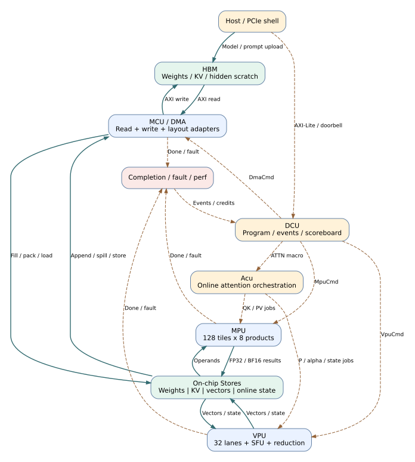
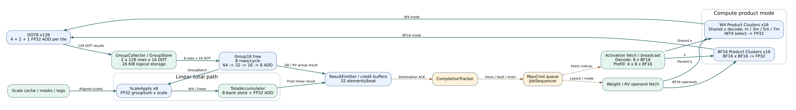
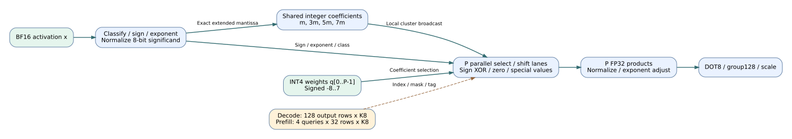
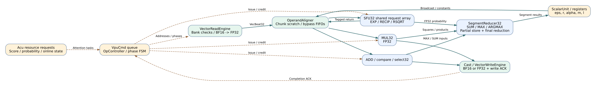
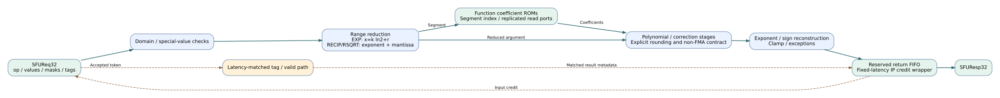
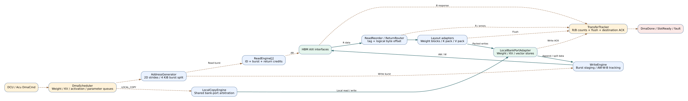
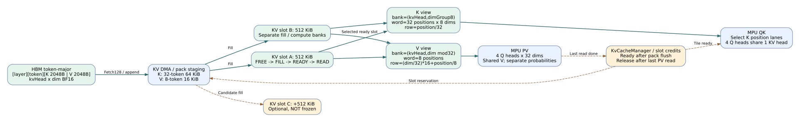
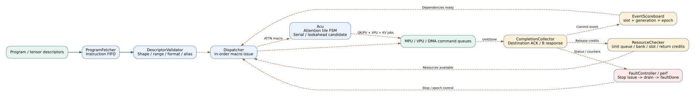
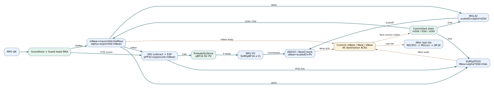

# NPU v0.5 架构图

优先查看同目录 `architecture.html`：所有SVG内嵌，无需网络。实线为数据，虚线为控制。

## 1. 顶层架构

实线是数据通路，虚线是命令、事件和资源控制。MCU为访存控制层，内部包含显式DMA子系统；Acu是attention控制器，共用MPU/VPU。PCIe DMA属于板卡shell。

## 2. MPU内部结构

W4使用共享激活解码与小整数产品；BF16通用路径用于QK/PV/lm_head。group tree每拍处理8行，8-lane scale为首版。所有不可反压的算术返回先预留credit。

## 3. W4产品单元与计算映射

同一BF16激活可被多个INT4权重复用。系数在扩展整数尾数域生成，不先舍入为BF16；最终形成FP32产品。该结构仍采用延迟scale数值模式。

## 4. VPU内部结构

32个物理lane；MUL、ADD/compare、归约与SFU为独立资源。原始gate/up等数据保存在对齐缓冲，标量阶段有独立进展通路。

## 5. SFU流水线

这是参数化实现框架，分段数量、系数、阶数和真实L/II还需prototype验证。32 lane需要足够的系数ROM读端口，不能用单读ROM直接满足32个不同index。

## 6. DMA子系统

DMA包含HBM读写、返回重排、布局适配和完成跟踪。KV_FETCH完成要等pack与片上写可见；KV_APPEND完成要等B响应。host PCIe DMA由shell提供。

## 7. KV存储与计算视图

HBM每layer/token存K2048B+V2048B。两slot功能基线各512KiB；第三slot为lookahead候选。K/V bank图是逻辑读视图，物理RAM组合和端口必须综合验证。

## 8. DCU与事件调度

顺序dispatch、显式事件、有限队列。Acu展开attention微任务；普通MPU/VPU controller展开自身循环。故障停新请求但排空已发AXI和固定延迟算术返回。

## 9. Online Attention数据流与依赖

旧m/l/o必须整tile提交后才供下一tile状态更新；下一tile的QK和score/max可以提前计算。FP32 p用于l，BF16 p用于PV，是当前待精度验证的数值模式。

