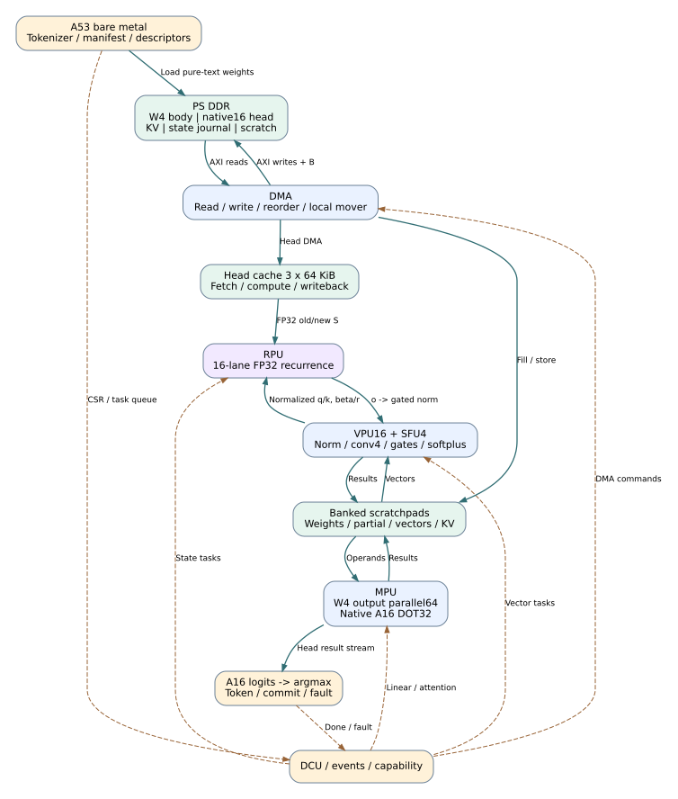
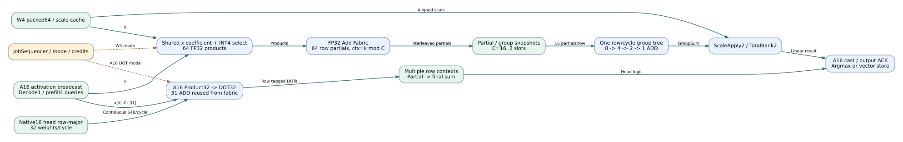
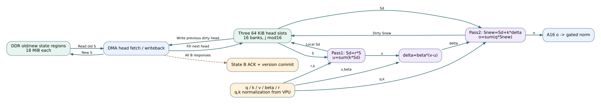
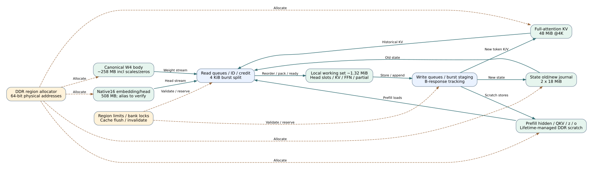
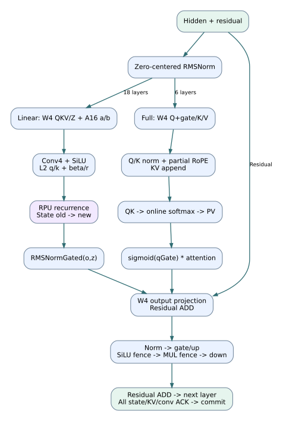

# 架构图

下载后打开`architecture.html`离线总览。实线数据、虚线控制。

## 顶层：纯文本异构NPU

A53裸金属负责软件与地址；PL中的MPU、RPU、VPU各处理不同工作。图中的并行数量是综合目标，第三方芯片内部并非如此推定。

## MPU：两种主要数据流

W4输出并行适合decode；原生词表DOT32保持row-major连续读取。FP32 ADD fabric按模式复用，模式切换前排空。

## RPU：一个head的两遍FP32处理

state为128×128 FP32；中间Sd留在片上，不重复扫DDR。所有head state写回确认后才发布token的新版本。

## 存储与DMA：工作集和版本分离

PS DDR为默认模型存储；PL DDR是待测可选路径。原生输出head读取约508MB/token，是首要带宽段。逻辑容量不等于物理BRAM占用。

## 混合层调度

18个linear layer走RPU；6个full layer走KV attention。Q投影包含gate，常规Norm使用1+weight，GDN输出另用gatedNorm。

