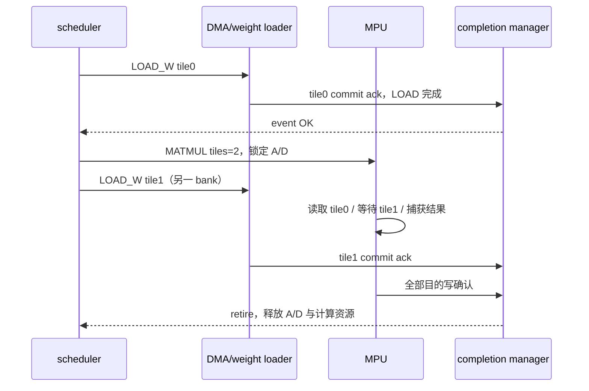

# 04 任务调度与 buffer 锁

状态：v0.1 建议控制；一个计算任务与一个 DMA 任务可重叠，按序发射而非按序等待完成。

## 1. 端口

所有端口属于 clk_core。task payload 保留完整 cmd_t，具体引擎只解码自己使用的字段。

| 信号 | 方向 | 类型 | 含义 |
|---|---|---|---|
| clk_core / rst_core_n / run_enable | I | 各 1 | 时钟、复位、全局使能 |
| issue_valid / issue_ready | I / O | 1 | 接前端 |
| issue_cmd / issue_error | I | 512 / 16 | 指令和静态错误 |
| issue_identity_error | I | 1 | 前端已发现与更早排队命令重名 |
| held_valid/held_job | O | 1/16 | 返回前端的当前命令身份，IDLE/HALT无新持有时为0 |
| dma_task_valid / ready / cmd | O / I / O | 1 / 1 / 512 | LOAD/STORE/LOAD_W |
| mpu_task_valid / ready / cmd | O / I / O | 1 / 1 / 512 | MATMUL |
| vpu_task_valid / ready / cmd | O / I / O | 1 / 1 / 512 | VECTOR/REDUCE/LAYOUT |
| sfu_task_valid / ready / cmd | O / I / O | 1 / 1 / 512 | SFU |
| event_lookup_slot/job | O | 8 / 16 | 请求查看依赖槽 |
| event_lookup_state | I | 3 | FREE/RUNNING/OK/FAILED/IDENTITY_MISMATCH |
| alloc_valid / alloc_ready / alloc_slot/job/opcode/irq | O / I / O | 1 / 1 / 8+16+8+1 | 发射前预约事件槽 |
| slot_probe_slot/slot_probe_free | O/I | 8/1 | 检查本命令event_slot是否空闲；越界视为非空且另报RANGE |
| id_query_job/id_query_busy | O/I | 16/1 | 查询事件槽及未消费CPL的job冲突，不包含当前队头自己 |
| admin_valid / admin_ready / admin_cmd | O / I / O | 1 / 1 / 512 | FENCE/RELEASE/命令拒绝事件请求，带拒绝 status |
| admin_event/admin_status/admin_irq | O | 128/16/1 | 完整完成payload、错误状态／无槽IRQ元数据 |
| admin_action/admin_target_slot/admin_target_job | O | 2/8/16 | NONE=0，RELEASE=1；其余非法 |
| retire_valid / retire_event | I | 1 / 128 | 完成已进入 CPL FIFO 的广播，无背压 |
| weight0_match / weight_fault | I | 1 / 1 | 当前 MPU job 的 tile0 已提交 / 身份错误 |
| fault_in / fatal | I / O | 1 / 1 | 系统故障输入 / 调度停发状态 |
| buf_enable / buf_bank / buf_base_word / buf_size_bytes | I | 8×(1/8/32/32) | 与memory_subsystem共用的有效配置；容量与别名校验依据 |

实际 RTL 可将 alloc / lookup / admin 合为事件表端口，但须保留下面的原子性。admin 的拒绝状态为独立 `admin_status[15:0]` 输出，正常行政命令为零。

run_enable在顶层RUN和DRAIN均为1，使已经接受的指令继续发射；仅RUN允许前端接新cmd。FAULT时停发。配置只在无任务／无在途请求的IDLE修改，scheduler与memory_subsystem不得维护彼此不一致的映射副本。

## 2. 资源与锁表

- compute_busy：MPU/VPU/SFU 任一发射后置 1，直到对应 retire 广播。不能在 core_busy 降低时清除。
- dma_busy：DMA task_fire 后置 1，直到对应 retire。允许与 compute_busy 同时为 1。
- 每 buffer 有 read_count、writer_job、writer_valid。共享读允许；写必须独占，同一任务的多个读引用去重。
- 原地许可任务对该 buffer 获取单个独占锁，不在同一任务内先加读锁再等待自身写锁。
- LOAD_W 不申请普通 scratchpad buffer 锁；其 bank 由 weight_tile_buffer 独立管理。MPU 的 A 和 D 仍申请普通锁。
- 所有锁一次性检查和获取，不采取“先占一半再等另一半”，避免锁间死锁。

锁集合：LOAD写dst；STORE读src0；MATMUL读A写D；VECTOR读所有有效源和SELECT mask、写dst；REDUCE读src0和可选mask写dst；SFU读src0写dst；LAYOUT读src0写dst。FENCE/RELEASE不访问存储。广播源和mask作为读buffer去重，mask与dst同buffer首版拒绝，防止更新后续尚未使用的mask。

## 3. 发射状态机

| 状态 | 行为 | 转移条件 |
|---|---|---|
| IDLE | 接管队头，锁存 cmd/error | issue_fire → CHECK |
| CHECK | 完成动态校验，确定 engine/锁集合 | 非法 → REJECT；正常 → DEP |
| DEP | 查依赖槽；无依赖立即通过 | OK → RESERVE；RUNNING 留；FAILED → REJECT |
| RESERVE | 等资源、空 event_slot、全部锁、MPU tile0 | 条件全满足时原子占槽和锁 → DISPATCH |
| DISPATCH | 对目标引擎保持 task_valid 和锁存 cmd | task_fire → IDLE |
| ADMIN | FENCE 等旧任务 / RELEASE 等目标完成，提交行政事务 | admin_fire → IDLE |
| REJECT | 保持错误行政请求，绝不触发 engine | admin_fire → IDLE |
| HALT | 停止接新队头，保持诊断 | 仅协调 reset 离开 |

检查点：若 task_ready 在 RESERVE 后变低，保留已预约资源并保持 DISPATCH；不能每拍重复 alloc。目标引擎 task_ready 不依赖自己收到 valid 后才清除旧任务，否则可能死锁。

CHECK先处理身份／slot有效性：重复job、越界slot、普通命令占用非FREE槽均无槽拒绝（占用槽返回EVENT_BUSY），不能停在RESERVE等软件排在后面的RELEASE。RESERVE只等待可用资源，不等待一个已被其他job占用的目标slot。IDLE未接管前held_valid=0；接管后到task_fire/admin_fire始终报告当前held_job，避免前端在发射边界漏掉重复ID。

普通计算／DMA在RESERVE同时占事件槽和全部锁，然后DISPATCH。FENCE只预约自己的事件槽、不置compute_busy/dma_busy，随后进入ADMIN等旧任务。EVENT_RELEASE跳过alloc和引擎资源，DEP通过后直接ADMIN。REJECT若身份及目标slot合法且空闲，可执行一次失败专用alloc后发FAILED事件；否则发slot=FF事件，绝不获取buffer锁。用reject_allocated位避免CPL背压下重复alloc。

DEP_EN 下若槽 FREE 或 job 不匹配，返回 DEP_MISSING，不无限等待未来生产者。生产者必须在指令顺序中更早发射。依赖 FAILED 返回 DEP_FAILED，消费者不访问存储。

MPU 权重 tile0 必须匹配 job/mode/g/S；完整 tile0 未到可以等待，但若所需 LOAD 被软件排在此 MATMUL 之后，队头顺序会死锁，属于程序错误，验证器应拒绝此序列。后续 tile 的 LOAD 可以排在 MATMUL 之后，因为 MATMUL 发射后调度已回 IDLE。

## 4. FENCE、释放与错误

FENCE 到达时不再发射后面的任务，等待此前 compute_busy=dma_busy=0、memory outstanding=0，然后创建成功事件。其自身事件槽在 RESERVE 时预约，不能将自身也计入等待集合。

为使FENCE可用作多生产者的成功汇合，scheduler维护barrier_error：复位／上一次合法FENCE提交后开始的区间内，任一普通任务或拒绝记录失败retire时置1。合法FENCE等更早任务全部retire后，barrier_error=0返回OK，否则返回DEP_FAILED，自己的槽置FAILED；FENCE行政事件提交后清该区间标志，不把自身失败重新灌入下一段。静态非法或DEP_MISSING等直接拒绝的FENCE不清该标志。host读取CPL、EVENT_RELEASE不能擦除barrier_error。

因此“创建成功事件”仅适用于区间内任务全部成功；后继依赖FENCE才同时获得数据可见性与失败传播。该首版汇合是整个发射区间的保守汇合，不能只挑选两个任意producer而忽略区间内其他失败。

EVENT_RELEASE 不占事件槽；目标 RUNNING 时等待，目标已完成且 completion 入队后可清槽。释放不减少尚未由 host 消费的 CPL 记录，job_id 重用仍需检查 CPL live ID。

ADMIN输出cmd、event、status、irq、action、target均由当前锁存命令构造，valid背压时全部保持；只有admin_fire才回IDLE。成功RELEASE用action=RELEASE；FENCE／拒绝和失败RELEASE均action=NONE，不得顺带清目标槽。

可恢复拒绝若 event_slot 合法且空闲，分配并置 FAILED；槽本身非法/已占用或 job 重复时只发无槽错误记录，不覆盖现存事件。前端/调度拒绝与引擎完成共享完成管理器，不绕过其容量控制。

fatal 可在任意状态进入 HALT。已发出的 memory response 仍由所属引擎接收，直到安全停止或 coordinated reset；锁进入隔离状态，不凭错误记录入队就释放为可用。

## 5. 典型交互

完成管理器 retire 广播与置依赖 OK 为同一提交事件，保证后继读不早于写可见。

## 6. 验收

同时读取同 buffer、读写冲突、原地任务锁去重、事件槽满但 RELEASE 仍能运行、计算/DMA 并发、FENCE 汇合、失败依赖传播、CPL 背压、错误期间锁隔离，以及 MATMUL 发射后确实可继续发 tile1 LOAD。
