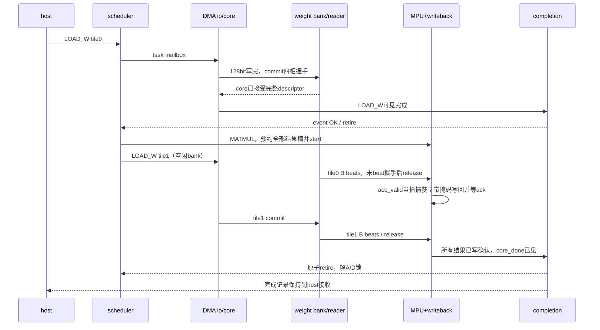

# 14 npu_top 顶层端口、连接、启动与恢复

状态：v0.1 连接合同；平台无关逻辑顶层提案。没有把18GB/s目标、FPGA频率或本轮文档当作已经实现的硬件性能。

## 1. 时钟域与实例结构

```text
npu_top
  core域：command_frontend → task_scheduler → mpu_engine / vector_engine / sfu_adapter
                                   ↓                       ↓
                             dma core bridge          memory_subsystem
  core域：result_writeback、weight_reader、completion_manager、fault/reset_control
  io域：  dma io controller、weight_loader、external_memory_adapter（平台外壳）
  跨域：  task/finish/row mailbox、普通LOAD/STORE async FIFO、权重双时钟RAM
          每bank commit/release mailbox、domain_ready/fault、性能快照mailbox
```

clock只通过明确的CDC结构传递数据；不要求clk_io与clk_core有整数频比。MPU与最终SFU使用clk_core，首版无独立DVFS域。

## 2. 顶层端口

方向相对npu_top；命令、完成和配置侧同步于clk_core，外存逻辑侧同步于clk_io。异步host或AXI桥由平台外壳负责。

| 信号 | 方向 | 域／位宽 | 合同 |
|---|---|---|---|
| clk_core/clk_io | I | 两域／各1 | 独立时钟 |
| reset_n | I | 异步控制／1 | 协调复位请求；各域同步释放产生rst_core_n/rst_io_n |
| platform_isolated | I | core／1 | 平台确认没有旧外存响应会被新事务接收；本域同步后提供 |
| run_req | I | core／1 | 配置完成后允许进入RUN；拉低只停止接新命令并排空 |
| cmd_valid/cmd_ready/cmd_data | I/O/I | core／1/1/512 | 前端命令流 |
| cpl_valid/cpl_ready/cpl_data | O/I/O | core／1/1/128 | 主机完成流 |
| cfg_valid/cfg_ready | I/O | core／1/1 | 配置事务 |
| cfg_write/cfg_addr/cfg_wdata | I | core／1/16/64 | 逻辑寄存器访问，地址以字节计，8B对齐 |
| cfg_rsp_valid/cfg_rsp_ready | O/I | core／1/1 | 单在途配置响应 |
| cfg_rdata/cfg_error | O | core／64/1 | 非法／忙时拒绝，不修改配置 |
| irq | O | core／1 | 完成IRQ挂起或fatal电平 |
| top_state/fatal/fatal_code | O | core／3/1/16 | 状态和首个不可恢复原因 |
| rd_req_valid/rd_req_ready | O/I | io／1/1 | 外存逻辑读事务 |
| rd_req_addr/rd_req_bytes/rd_req_tag | O | io／64/32/16 | 每行一个事务 |
| rd_valid/rd_ready/rd_data | I/O/I | io／1/1/128 | 固定128bit输入 |
| rd_keep/rd_last/rd_tag/rd_error | I | io／16/1/16/1 | [06](06_dma_engine.md)帧合同 |
| wr_req_valid/wr_req_ready | O/I | io／1/1 | 外存逻辑写事务 |
| wr_req_addr/wr_req_bytes/wr_req_tag | O | io／64/32/16 | 外存目的和长度 |
| wr_valid/wr_ready/wr_data | O/I/O | io／1/1/EXT_WR_W | 参数化输出，不由128bit输入推定 |
| wr_keep/wr_last/wr_tag | O | io／EXT_WR_W/8、1、16 | 按有效字节计长 |
| wr_rsp_valid/wr_rsp_ready | I/O | io／1/1 | 写确认 |
| wr_rsp_tag/wr_rsp_error | I | io／16/1 | 对应原写请求 |

reset_n断言必须同时使两域协议状态复位；若只有一个时钟停住，另一域不得自行重新进入RUN。platform_isolated必须由平台对已接受事务真实终止或隔离后给出，不能仅将本地outstanding清零来伪造。

## 3. 配置／状态地址提案

配置接口每次最多一个请求，响应保持至cfg_rsp_fire。只读状态可在RUN中读，buffer映射写只允许IDLE且所有内部队列／握手空闲。非法写返回cfg_error，不部分更新。

| 地址 | 属性 | 内容 |
|---|---|---|
| 0x0000 | RO | VERSION，低32bit=0x00010000（本提案版本），高位0 |
| 0x0008 | RO | STATUS：[2:0]top_state、bit3 fatal、bit4 core_ready、bit5 io_ready，其余0 |
| 0x0010 | RO | CAPABILITY：[8:0]SFU subop（每位一个 subop，bit0=EXP2…bit8=TANH）、[11:9]SFU格式、bit12 LAYOUT、bit13 ROTATE_PAIR、bit14 MASKED_REDUCE，其余0 |
| 0x0018 | RO | WIDTHS：低16 IO_DATA_W、次16 MEM_DATA_W、再16 EXT_WR_W、最高16 WBUF_K_STEPS |
| 0x0020 | RO | LIMITS：[7:0]M_CAP、[15:8]G_CAP、[31:16]RESULT_SLOTS、[47:32]EVENT_SLOTS，[63:48]为0 |
| 0x0028 | RO | FATAL_INFO：低16fatal_code、次16首错job_id、高32首错aux |
| 0x0030 | WO | COUNTER_SNAPSHOT，bit0写1启动io计数快照，其余0 |
| 0x0038 | RO | SNAPSHOT_STATUS：bit0busy、bit1valid、[63:32]generation，其余0 |
| 0x0100+0x20*b | RW | buffer b 配置：bit0 enabled、[15:8]bank_id、其余0 |
| 0x0108+0x20*b | RW | 低32 base_word，高位0 |
| 0x0110+0x20*b | RW | 低32 size_bytes，高位0 |
| 0x0118+0x20*b | RO | 当前buffer reader数／writer_valid／writer_job，诊断布局由profile固定 |
| 0x1000+8*i | RO | [13](13_completion_and_fault.md)列出的64bit计数，按文中顺序编号i |

启动时对全部buffer映射做一次非重叠、bank深度和对齐校验；run_req前由软件完成字段配置。多寄存器修改期间不能开放任务。未定义地址返回cfg_error；没有暗含的清fatal／单域reset寄存器。counter snapshot通过状态轮询完成，不阻塞正在执行的计算。

## 4. 实例连接矩阵

| 源 | 目的 | 信号组／关键约束 |
|---|---|---|
| host | command_frontend | cmd_*；accept_enable仅RUN且无fatal；已接队列在RUN/DRAIN均可出队 |
| command_frontend | task_scheduler | issue_valid/ready/cmd/error；队列job检查见03 |
| 顶层控制／配置 | scheduler／memory_subsystem | run_enable在RUN/DRAIN为1；共用buffer映射寄存器输出，IDLE才可修改 |
| scheduler | DMA/MPU/VPU/SFU | 各task_*；LAYOUT进入VPU内tensor_layout |
| scheduler | completion_manager | alloc、lookup、id_query、ADMIN事件+action/target；所有字段在背压时稳定 |
| completion_manager | scheduler | retire广播；仅此沿正常释放任务／锁 |
| DMA/MPU/VPU/SFU/ADMIN | completion_manager | 五个128bit事件源；LAYOUT复用VPU源 |
| MPU activation_packer | memory客户端0 | A读取 |
| VPU与tensor_layout本地mux | memory客户端1 | 逐元素、归约、重排，单任务选择 |
| SFU adapter | memory客户端2 | 输入和输出平面 |
| result_writeback | memory客户端3 | 带strobes写目的与确认 |
| DMA core bridge | memory客户端4 | 普通LOAD/STORE |
| MPU | result_writeback | job预约、acc脉冲、done/status/tiles；acc直连已预约捕获端 |
| MPU | weight_reader | select、B stream、tile_done；精确job/tile/config匹配 |
| scheduler | weight_reader | query_job/tile/mode/g/s与match/fault；只查询当前队头tile0 |
| DMA io | weight_loader | LOAD_W cmd、128bit data、done |
| weight_loader／reader | 双时钟RAM | io写／core读；提交／释放分立mailbox |
| 全模块 | fault/reset_control | 本域fatal锁存、首错metadata；io错误与终结mailbox关联 |

ADMIN不是第六种执行引擎，是scheduler保持的完成源。FENCE／拒绝／EVENT_RELEASE都进入同一源；RELEASE目标清槽与行政完成CPL入队原子发生。13中的release_*是该ADMIN事务的内部别名，不可另接一条会提前清槽的旁路。

MPU事件必须由mpu_engine汇合core_done、捕获数量、最后bank安全释放、writeback确认后发出；不把result_writeback.done再独立接到完成管理器。IRQ信息保存在预约槽／行政sideband中，128bit记录自身不含IRQ位。

## 5. 顶层状态机

| 编码／状态 | 行为 | 离开条件 |
|---|---|---|
| 0 RESET | 两域协议清空；所有对外valid=0，cmd_ready=0 | reset释放→BOOT |
| 1 BOOT | 各域同步释放、FIFO reset_busy消失、交换domain_ready | 双域就绪且platform_isolated→IDLE |
| 2 IDLE | 允许配置、读状态；不接cmd | run_req且映射／profile合法→RUN |
| 3 RUN | 开命令、发射、数据流与完成 | run_req=0→DRAIN；任何fatal→FAULT |
| 4 DRAIN | 关cmd_ready，继续处理已接受队列和在途任务／完成 | 前端／调度／引擎／memory／CDC全空→IDLE |
| 5 FAULT | 停新命令／发射，隔离资源，保留可安全接收的响应和完成 | 仅平台隔离并协调reset→RESET |

正常DRAIN不要求依赖表为空，也不要求host已读全部CPL；它要求所有已接受命令都已经提交完成，且无活跃任务。若CPL满，host须继续读取以便排空。IDLE保留已完成事件，允许在下一RUN用EVENT_RELEASE清理；改变buffer映射仍要求所有任务和旧请求为空。

domain_ready本地域寄存、对方通过同步器可见；一次reset后必须看到新的低→高初始化过程，不能沿用旧的高电平。双域reset握手与平台事务隔离属于reset_control责任，不能只凭两个自由运行时钟数固定拍数认定恢复。

## 6. 完整交互时序



无需CPL host消费才能解锁，但必须先有CPL空位完成提交。依赖槽释放与host消费各自独立；新job_id同时检查事件表、调度在途与未消费CPL。

## 7. 参数profile与容量检查

01中的默认值只适合小尺寸仿真。WBUF_K_STEPS=256意味着W4完整K≤4096、W16完整K≤1024；0.5B–3B的参数规模不能唯一确定最大K，需要最终模型hidden/intermediate/head/context维度。更大完整K要增bank容量或显式部分和方案，首版MATMUL不会自动跨job归约。

权重RAM逻辑位数（未计宏粒度／ECC）为：

```text
2 banks * G_CAP * (256*WBUF_K_STEPS + 128*ceil(WBUF_K_STEPS/4))
默认为1,179,648 bit = 144 KiB
result RAM默认 = RESULT_SLOTS*4096 bit = 1 KiB
scratchpad = Σ enabled buffer.size_bytes（物理bank留白另算）
```

每128bit输入拍最多16B；理想带宽=16*f_io，250MHz为4GB/s，18GB/s需要1.125GHz且100%利用率。双时钟RAM／FIFO只解耦速率与突发，不放大平均带宽。本版不设置虚构的f_io；仿真用无固定比的两个时钟验证协议，综合后另提供时序／CDC约束。

启动profile还必须核对现有MPU的4×8×4结构、mode映射、SFU能力关闭／启用依据、V_LANES约束、buffer全部可用范围和外存测试区大小。参数不合法时留在IDLE并给配置错误，不带着截断后的尺寸开始计算。

## 8. reset、错误与验收

运行中的单域意外reset、权重commit/release矛盾、输入帧缺失等进入FAULT；在复位破坏协议后不能承诺每条已接受任务仍有CPL，平台软件用reset generation界定整批任务作废并重建。正常运行中则保持每任务恰好一完成。

验收覆盖启动／停机、配置忙拒绝、两域任意复位相位、platform_isolated延后、CPL满时DRAIN、DMA与计算并发、全部连接的背压稳定、MPU最后输入与最后写确认间隔、跨域多次ping/pong、fatal先锁存再错误retire，以及[15](15_validation_and_sequences.md)的小尺寸整层序列。当前仅完成合同，不宣称仿真／综合通过。
