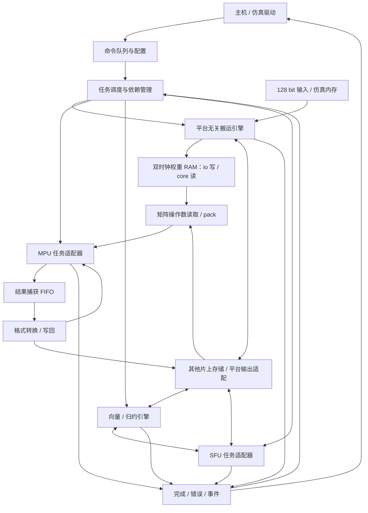

# NPU 顶层与外围模块设计草案

状态：v0.1架构与模块详细设计；已有建议指令编码，尚未冻结为ABI，也未确定SRAM容量和物理总线参数。更新：2026-10-29。

## 文档导航

本轮将各模块展开到端口方向／位宽／时钟域、指令字段、状态转移、背压、完成与错误边界。以下编号文档是当前详细合同；本文和两个背景文档负责整体解释，编码和连接细节以编号文档为准。

| 编号 | 文档 | 主要内容 |
|---|---|---|
| 01 | [公共协议与参数](01_common_protocol.md) | 握手、类型、错误码、默认profile |
| 02 | [指令格式](02_instruction_set.md) | 512bit头／payload、opcode、依赖与字段校验 |
| 03 | [命令前端](03_command_frontend.md) | FIFO、合法性、排队身份检查 |
| 04 | [任务调度](04_task_scheduler.md) | 原子预约、buffer锁、双引擎并发、FENCE |
| 05 | [片上存储](05_memory_subsystem.md) | 五客户端、bank仲裁、SRAM wrapper、写确认 |
| 06 | [DMA与普通数据CDC](06_dma_engine.md) | 128bit帧、2D搬运、异步FIFO／mailbox |
| 07 | [权重缓存](07_weight_buffer.md) | 装填位序、双时钟RAM、ping/pong提交／释放 |
| 08 | [MPU任务适配](08_mpu_engine.md) | 现有端口映射、A打包、start／done生命周期 |
| 09 | [结果写回](09_result_writeback.md) | 无ready结果捕获、整job预约、分拍／掩码 |
| 10 | [VPU与归约](10_vector_engine.md) | 浮点运算、广播、masked归约、RoPE配对 |
| 11 | [SFU适配](11_sfu_adapter.md) | 原语编码、最终核profile、SINCOS与异常 |
| 12 | [格式与数值](12_format_and_numeric.md) | RNE、FTZ、转换器及现有核数值边界 |
| 13 | [完成与故障](13_completion_and_fault.md) | 事件表、CPL、IRQ、fatal、计数快照 |
| 14 | [顶层连接](14_npu_top.md) | 外部全部端口、实例连接矩阵、配置、boot／reset |
| 15 | [验证与指令序列](15_validation_and_sequences.md) | 可核对的小矩阵、算子／整层调度、验收矩阵 |
| 16 | [布局与KV路径](16_tensor_layout_and_kv.md) | TRANSPOSE／PACK、QK/PV、GQA与外存KV |

背景推导：[接口与流控](interfaces.md)、[128bit双时钟权重路径](weight_path.md)。所有新增模块仍为设计提案；当前工作区的已有MPU/SFU接口与提案端口分别标明。

## 1. 已确认的设计目标

- 先做平台无关 RTL 和仿真，再适配 FPGA 或 ASIC。
- 面向 Transformer 的 prefill 和 decode，暂不绑定具体模型。
- 目标模型规模为 0.5B–3B 参数；矩阵核已有 W4A16 和 W16A16 两类数据路径。
- 外部数据输入总线暂定为 128 bit，使用独立的 `clk_io`；计算阵列使用 `clk_core`。
- 以 ZCU102 为能力参考，约 18 GB/s 是待验证的系统带宽目标；单条 128 bit 输入的可用带宽仍由频率和利用率决定，不能直接等同。
- 外部权重经双时钟双口 RAM 搬入片上分块缓存；两个时钟域按异步关系设计。
- GEMV 使用一行及可配置数量的列组；列组数依据供数带宽、布局和任务尺寸选择，不要求全部阵列始终工作。
- 保留已有矩阵运算单元和 SFU 的设计边界；外围负责搬运、存储、格式转换、调度和完成管理。
- 本稿依据当前工作区的实际接口，不继承旧根 README 中的 HBM、SpinalHDL、固定 lane 数或特定模型假设。
- 当前交付仅是设计文件，不代表外围 RTL、完整 SFU 数值实现或端到端模型验证已经完成。

## 2. 当前计算单元的接入基线

| 项目 | 当前文件中可确认的行为 | 对顶层的约束 |
|---|---|---|
| MPU 阵列 | `tensorcore/rtl/gemv_cluster.v`，4 行 × 8 列组，每组 4 个输出 | 一个结果 tile 固定为 4 × 32 个 FP32 |
| MPU 操作数 | A 1024 bit；B 2304 bit，其中权重 2048 bit、scale 256 bit | 操作数打包必须遵守实际位序，不能按普通线性矩阵直接接线 |
| MPU 格式 | mode 00/10 为 W4×FP16/BF16；01/11 为 FP16/BF16 乘法路径 | 不能把 W4 的 K 步长 16 与 W16 的 K 步长 4 混用 |
| MPU 封装 | `gemv_stream.v` 含两个深度 8 的 FIFO、输入与输出计数 | `start` 和配置由外层任务适配器管理 |
| MPU 结果 | `acc_valid` 脉冲 + 4096 bit `acc_out`，无 `acc_ready` | 每次结果出现都必须当拍捕获；不能用下游 ready 直接暂停结果 |
| MPU 完成 | `busy` 随最后一个输入 beat 发出而清零；`done` 按结果数计数 | `!busy` 不等于任务完成，不允许据此改配置或启动下一任务 |
| MPU 累加器 | 当前 RTL 是单 bank，源码没有 bank 选择端口 | 当前 tensorcore README 中双 bank 的描述不能作为接线依据 |
| SFU 接口 | `sfu_top.v` 使用 valid/ready、格式、op、mode、status 和 flush | 需要独立任务适配器，输出遵循握手和稳定性约定 |
| SFU 当前快照 | 顶层默认 WIDTH=8，固定实例化两个 4 元素 slice；文档主方案为 4 lane | 不将 WIDTH 当成已经验证的任意 lane 参数；接入前对齐最终版本 |
| SFU 当前实现 | `sfu_slice.v` 明确标注 placeholder，主要是透传和整数倒数；微序列器尚未接入顶层 | 可以讨论接口，不能据此声称 EXP/RSQRT/SINCOS 数值功能可用；需要用户已完成的最终实现 |

上述最后两项是当前目录文件的状态，不否定已有的独立 SFU 设计。外围设计不自行重写它。

## 3. 建议的顶层结构



图中的 VPU↔SFU 表示向量算子对非线性原语的调用关系。首版允许通过片上存储交换中间量，不要求直接旁路。

```text
npu_top
├── command_frontend       命令握手、排队、合法性检查
├── task_scheduler         任务发射、依赖、资源与 buffer 所有权
├── memory_subsystem       激活 / KV tile / 临时量 / 状态scratchpad（权重另设）
│   ├── bank_arbiter        访问仲裁和读响应路由
│   └── sram_wrapper        统一逻辑接口；后续替换成 BRAM 或 SRAM 宏
├── dma_engine             core任务桥 + io搬运控制 + 普通数据CDC
├── weight_tile_buffer     双时钟 RAM，ping/pong 所有权和提交 / 释放 CDC
├── mpu_engine
│   ├── operand_packer     A / B / scale 布局与补零
│   ├── task_adapter       配置锁存、输入计数、结果容量预约
│   └── gemv_stream        已有模块，内部实例化 gemv_cluster
├── result_writeback       结果捕获、分拍、掩码、FP32→FP16/BF16
├── vector_engine          逐元素运算、广播、归约、类型转换、tensor_layout
├── sfu_adapter            最终 SFU 接口适配、任务跟踪、写回
└── completion_manager     完成事件、错误、性能计数
```

这些是逻辑职责，不要求每项单独成为一个 RTL 文件。具体命名和模块边界在接口评审后冻结。

## 4. 外围模块的设计职责

| 模块 | 首版必须负责 | 暂缓的复杂度 |
|---|---|---|
| 命令前端 | valid/ready 接收描述符，校验 opcode、格式、维度和 buffer 范围，锁存 job_id | 片上通用 CPU、复杂取指缓存 |
| 任务调度 | 首版计算任务顺序发射，依赖完成后启动；支持搬运到不冲突的 buffer | 多计算任务乱序执行、推测执行 |
| 片上存储 | 明确各逻辑 buffer 的端口、bank、访问粒度、所有权和读延迟 | 自动硬件 cache、未定器件的物理映射 |
| DMA / 权重缓存 | 128 bit 输入、长度与 stride、双时钟 RAM 装填、错误转发、bank 所有权 CDC | 固定 AXI/HBM 协议、假定两时钟同源或同相 |
| MPU 适配器 | 保持配置直至结果排空；只写入精确数量的 A/B beat；结果容量预约 | 未验证的无限 job 连发 |
| 结果写回 | 无损捕获整 tile；按存储端口分拍；只写有效行列；按需舍入转换 | 将 4096 bit 结果直接作为外部总线宽度 |
| VPU | ADD/SUB/MUL、比较/选择、标量广播、SUM/MAX 归约和格式转换 | 初版强制独立 FMA、固定 lane 数或全算子融合 |
| SFU 适配器 | 锁存 op/format/mode，输入输出计数，异常聚合；SINCOS 双输出协议 | 假定所有函数都是单拍或同一延迟 |
| 完成管理 | job_id 对齐、写回确认、错误可追踪、完成握手 | 把输入发完或计算核 done 直接当成全系统完成 |

## 5. 片上存储与供数

采用显式管理的 scratchpad。DMA 与执行引擎只访问已分配的逻辑 buffer，不由计算单元自行访问外存。

- **Activation buffer**：保存输入、残差与层间输出；支持同一激活 tile 按 N tile 重读，避免每次都从外存重取。
- **Weight buffer**：保存已按矩阵核格式预打包的权重和 scale；首版使用 ping/pong 逻辑 bank，`clk_io` 装填、`clk_core` 读取。发布完整 tile 后才允许读取，释放确认后才允许覆盖。
- **KV tile buffer**：只缓存当前处理的 K/V 分块；完整 KV cache 默认在外部内存，实际驻留策略待模型确定。
- **Vector / temporary buffer**：保存归约中间量、softmax 临时值、归一化参数和 SFU 输入输出。
- **Attention state buffer**：预留 online attention 的每行 m、l 和向量 o；只有实现分块在线方案时才分配。
- **Result FIFO**：保存不可背压的 MPU 输出，按 tile 计容量，不能与操作数浅 FIFO 混为一谈。

buffer 的字节容量、物理 bank 数、读写端口数量仍需结合目标维度、VPU lane 数和 SRAM 实现计算。

按当前端口计算，满行 W4 的一个输入 beat 为 A 128 B + 权重 256 B + scale 32 B = **416 B**。
这是片上接口的供数需求，不是每拍都必须从外存读入 416 B。W16 路径不使用 scale，且每行仅低 64 bit A 有效，
外围可以减少存储读取量后再展开到物理端口。外存流量必须按实际重用策略另算。

一个输出 tile 固定 **512 B**。假设仅用于说明的 256 bit 写回端口，写出一个整 tile 至少需要 16 个成功握手周期；
如果 MPU 每隔少于 16 拍产生一个 tile，则必须用调度限流或更宽/更多写端口保证持续吞吐，有限 FIFO 只能吸收短暂突发。

这里的 256 bit 只是写回示例，不是已确定的外部接口；当前已确定的是 **128 bit 输入**。结果输出总线是否共享、宽度和时钟域仍待确定。
双时钟权重缓存及部分列启用的详细推导见 [128 bit 双时钟权重路径](weight_path.md)。

### MPU 的首版保守流控

保持现有 `gemv_stream` 不变时，采用整 job 预约：

1. 接收 job 前，确认该 job 的全部 `tiles` 都有已预约的结果空间。空间可由专用 FIFO 提供；若用结果 SRAM，则捕获端仍须保证每个结果当拍可接收。
2. job 超过可预约容量时，由调度器拆成多个 job；不在 `gemv_stream` 运行中试图新增结果背压。
3. 配置从任务启动一直保持到 `done` 已到达且全部结果已被下游接收。
4. 对顶层的任务完成，还必须等待目的存储或外部写事务确认。

后续若需要逐 tile 预约和更细流水，可在 `gemv_cluster` 外增加新 sequencer，直接控制 `beat_en`。
已有 `gemv_stream` 和算术数据通路保留，不能只在结果端增加 ready 就声称实现了流控。

## 6. 命令与完成模型

主机或参考调度程序生成执行描述符；首版由顶层按顺序解释，不强制实现复杂的模型级微码处理器。

建议命令类别：`LOAD / STORE / MATMUL / VECTOR / REDUCE / SFU / LAYOUT / FENCE / EVENT_RELEASE`。
v0.1建议opcode、512bit字段和保留位规则已经写入[02](02_instruction_set.md)，尚未冻结为软件ABI；WAIT由依赖+FENCE表达，不另设opcode。

通用字段包括：job_id、操作类别、输入/输出格式、源/目的 buffer、字节偏移、有效长度或 M/N/K、
矩阵stride、可选立即数、依赖事件。字段位宽使用02的统一提案，模型尺寸仍由描述符／profile指定。

任务完成分三层：

1. **输入完成**：全部操作数已交给计算核；buffer 何时可释放还需考虑实际读完成。
2. **计算完成**：计算核报告结果已产生。
3. **可见完成**：结果已提交到目的存储，相关写响应已确认，此时才发布完成事件并解除后继任务依赖。

正常事件与错误事件都按 job_id 返回，完成记录在 valid=1、ready=0 时保持稳定。
非法命令不得向计算核发出 start。异常处理必须先停止新任务，并排空/跟踪已接受的内存事务，
不能直接清零 outstanding 计数后报告恢复。

## 7. VPU / SFU 分工与数值边界

VPU 负责基础算术和归约；SFU 提供非线性原语。两者共同完成上层算子：

| 算子 | VPU / 归约部分 | SFU 部分 |
|---|---|---|
| RMSNorm | x²、sum、乘 1/N、加 eps、逐元素乘 gamma | RSQRT |
| Softmax | max、减 max、乘 log2(e)、sum、归一化乘法 | EXP2、RCP |
| SiLU | 符号变换、缩放、加 1、乘 x | EXP2、RCP |
| RoPE | 按维度配对、旋转乘加 | 查表得到 sin/cos，或调用 SINCOS |
| Residual / gated MLP | ADD、逐元素 MUL | SiLU 的非线性子步骤 |

- 内存激活支持 FP16/BF16；归约、矩阵累加、softmax 的关键状态使用 FP32。
- FP32 结果何时转回 16 bit 必须显式编码；不能在每个中间步骤隐式截断。
- VPU lane 数和其与 SFU 的比例是待评估参数，不能把现有文档中的 4 或当前 RTL 的 8 自动扩展成全芯片约束。
- 需要独立格式转换器，并明确 RNE、FTZ、NaN/Inf、溢出和异常传播；格式转换本身也是验证对象。
- 现有 MPU 文档限定 reduce4/acc 的 normal/±0 范围且 BF16 W4 宽指数跨度有近似；整机误差参考需遵守该边界。
- W4 scale 为 E8M0，且按 PE 分配，并非任意 per-column 浮点 scale。模型量化权重必须验证可映射性；一般 GPTQ 权重不能仅凭名字就认为可直接使用。

## 8. Transformer 执行路径

首版优先验证可分解的算子序列，先保证数据布局、数值和依赖正确，再增加跨算子融合。

```text
输入 / 残差
  → RMSNorm
  → Q/K/V projection
  → Q/K 的 RoPE（若目标模型包含）
  → 写入 KV cache
  → QKᵀ / attention scale / causal mask
  → Softmax
  → P·V
  → O projection + residual
  → RMSNorm
  → gate / up projection → SiLU(gate) × up
  → down projection + residual
  → 下一层
```

这是典型 decoder 层候选路径，不是对尚未确定的目标模型的算子承诺。Norm、激活函数、位置编码、
Q/K Norm、GQA/MQA 等特性以最终模型配置为准。

- **prefill**：矩阵 M 方向按最多 4 行切 tile；causal mask 同时考虑 query 位置、已有 KV 长度和 key 位置。
- **decode**：m_len=1，n_grp 按供数预算选 1..8 个列组（每组 4 个输出列）；追加当前位置的 KV，再读取合法历史 KV；GQA 的 KV head 映射交由地址生成器显式计算。
- **N 尾部**：现有核只能按 4 列组关闭单元，组内不足 4 列需补零，并由写回端屏蔽多余列。
- **K 尾部**：W4 按 16、W16 按 4 补齐，pack 端构造零填充，不能越界读取原始张量。
- **attention 基线**：先用分块搬运及显式中间 buffer 验证正确性，并限制参考用例尺寸；不宣称能存下任意长度的完整 S/P 矩阵。
- **动态B布局**：QK/PV的K/V须TRANSPOSE/PACK成现有核B帧。当前只有io权重写入口，功能基线经STORE外存再LOAD_W返回，额外流量见[16](16_tensor_layout_and_kv.md)，不能隐含一个不存在的core直写旁路。
- **长上下文方案**：增加 online softmax 状态和 o 的重缩放，避免完整 S/P 驻留；这是后续独立验收项。
- **mask 数值**：MPU 不支持完整 Inf 语义，不能把 `-Inf` 掩码值未经处理送入矩阵核；被 mask 的概率必须在 VPU/SFU 路径明确写成零。

## 9. 建议的设计与验收顺序

| 阶段 | 交付 | 必须通过的检查 |
|---|---|---|
| A | 接口合同、MPU 任务适配器、结果捕获和写回 | 单/多 tile、K=1、随机供数停顿、下游长背压、配置锁存、连续 job、非法命令 |
| B | scratchpad、bank 仲裁、128 bit DMA、双时钟权重缓存与仿真内存 | 无固定频比的双时钟、提交/释放 CDC、地址/stride/尾部、bank 冲突、错误响应、双缓冲所有权 |
| C | VPU、归约、格式转换、最终 SFU 接入 | SUM/MAX、RMSNorm、Softmax、SiLU、RoPE，逐项数值与握手检查 |
| D | 描述符调度、依赖、整层顶层联调 | prefill/decode 的小尺寸 decoder 层，与独立参考模型比较 |
| E | online attention、性能计数、平台适配 | 长上下文状态正确性、真实吞吐瓶颈、指定器件综合与时序 |

A/B 的局部模块可独立推进；C 中 SFU 的真实数值验收依赖最终实现。
第一版功能仿真即使用独立的 `clk_io` 与 `clk_core`，验证不同频比与相位；具体频率尚未冻结。
跨域 RAM、控制 CDC 和各域复位释放是首版必须验证的内容，物理宏与时序约束由后续平台适配落实。

## 10. 实施前仍需确认的设计项

1. 评审01..16的v0.1合同，冻结端口／编码；当前均已给出建议方案，尚无外围RTL实现。
2. 结合最终模型最大K和实际存储预算选择WBUF_K_STEPS、普通scratchpad、结果槽；默认值只用于小尺寸仿真。
3. 确定VPU lane数／浮点实现、layout性能及动态B是否升级core直达路径。
4. 对齐已有SFU最终RTL的lane、fmt、status、SINCOS帧和数值能力；当前工作区占位版不作为数值验收依据。
5. 用15的小矩阵先联通，再冻结具体模型、误差阈值、频率／物理接口和实际性能目标。

详细集成合同见 [接口与流控](interfaces.md)。
