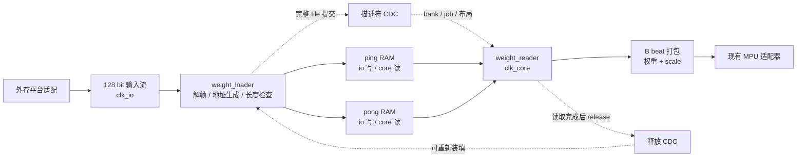

# 128 bit 双时钟权重路径与带宽预算

状态：外围微架构讨论稿，未实现 RTL 或完成 CDC / 板级测量。更新：2026-10-29。

## 1. 当前边界与 18 GB/s 的含义

- 保留现有矩阵核的 W4A16 / W16A16 路径，不修改其算术实现。
- 输入目前假定为一条 128 bit、每个 `clk_io` 上升沿最多接受一次传输的 valid/ready 流。
- `clk_io` 与 `clk_core` 独立；具体频率均未确定。
- 用户提出以 ZCU102 能力为参考、约 **18 GB/s**。目前将它记为系统带宽评估目标，不能视作单条 128 bit 接口已实现的持续带宽。
- 目标仍为平台无关 RTL / 仿真，之后适配 FPGA / ASIC；ZCU102 只提供实现能力参照。
- 下文 GB/s、GB 均为十进制；GiB 为二进制。

单条输入接口的原始上限为：

```text
B_port = 16 × f_io               [byte/s，f_io 单位 Hz]
f_io_required = 18e9 / 16
              = 1.125 GHz        [理想情况，无停顿]
```

| 逻辑输入组织 | 示例时钟 | 原始上限，不含停顿 |
|---|---:|---:|
| 1 × 128 bit | 200 MHz | 3.2 GB/s |
| 1 × 128 bit | 250 MHz | 4.0 GB/s |
| 1 × 128 bit | 300 MHz | 4.8 GB/s |
| 4 × 128 bit 或 1 × 512 bit | 300 MHz | 19.2 GB/s |

因此有两个需要分别评估的配置：

1. 保持单路 128 bit：按实际 `f_io` 预算，不能直接使用 18 GB/s 推导列组数。
2. 将来争取接近 18 GB/s：考虑多条 128 bit 通道或更宽的聚合接口。宽度转换后的内部窄接口仍受自身吞吐限制，不能靠 FIFO 消除瓶颈。

第二项是设计选项，尚未替用户冻结为四通道或 512 bit。多通道还需要分流、写 bank 冲突仲裁、顺序恢复与足够在途事务。

### ZCU102 参照的适用范围

板级评估需先明确具体板卡版本、DDR 通路、控制器配置、到 PL 的端口与共享流量。外部存储器的数据速率不等于单个 NPU 输入口的持续吞吐。
因此 **用户提供的 18 GB/s 可作为初步系统预算目标，但尚无本项目板级实测支持**；需要用目标通路的长突发和真实访问模式验证 NPU 可用份额。

后续平台适配参考资料：AMD《ZCU102 Evaluation Board User Guide》UG1182；AMD《System Performance Analysis User Guide》UG1145 的 Evaluating High-Performance Ports。这里不据未确认的控制器配置锁定输入时钟。

## 2. 数据路径和模块划分



这里的“异步 RAM”具体指 **独立读写时钟的双口 RAM**，不是组合异步读存储器。
RAM 承载数据，提交 / 释放协议转移所有权；不能仅有 RAM 而省略控制跨域。

首版一个 ping/pong bank 保存一个输出 tile 对应的全部 K-step 权重；多 tile job 按 tile 顺序换 bank。
描述符中保留 `job_id / tile_index`，不能让后装填的 tile 抢先进入当前计算流。
首版假定单 tile 的完整 K 能放入 bank；若不够，先缩小验证尺寸或扩大参数容量。
跨 K 分块需要保证仅最终块触发 `last`、累加器不被清除，并修改对应 feeder 合同，不能直接拆成互不相干的 `gemv_stream` job。

| 模块 | 所在域 | 责任 |
|---|---|---|
| weight_loader | clk_io | 接受描述符，按握手写 RAM，统计 weight/scale 长度，完整后提交 |
| weight_tile_buffer | 双域 | ping/pong 存储、每 bank 控制 mailbox、提交/释放 CDC |
| weight_reader | clk_core | 锁存描述符、读取有效组、处理读延迟、拼 B beat、应对下游背压 |
| MPU 任务适配器 | clk_core | A/B 数量与顺序、配置生命周期、不可背压结果容量预约 |

激活来自计算域 activation buffer；不要求和权重在每一个外部传输周期同时到达。
输入 128 bit 不限定结果输出接口宽度。

## 3. 按现有 RTL 计算供数

依据 `tensorcore/rtl/gemv_cluster.v` 与 `gemv_unit.v`：

- 阵列为 4 行 × 8 列组，每组 4 个输出列。
- `n_grp=g` 选择前 g 组，合法范围 1..8；当前接口不是任意列 mask。
- W4 每 K-step 处理 K=16；W16 每 K-step 处理 K=4。
- 每有效列组每 K-step 使用 256 bit = 32 B 权重。
- W4 另使用四个 E8M0 scale，共 32 bit = 4 B；W16 不使用 scale。

| 模式 | 权重 / 组 / step | scale / 组 / step | GEMV MAC / 组 / step |
|---|---:|---:|---:|
| W4A16 | 32 B | 4 B | 64 |
| W16A16 | 32 B | 0 | 16 |

设 `S=k_steps`，则有效权重载荷为：

```text
W4:  W_payload = 36 × g × S bytes
W16: W_payload = 32 × g × S bytes
S_W4  = ceil(K / 16)
S_W16 = ceil(K / 4)
```

固定同一 K/N 时，W16 的 S 是 W4 的约四倍；不能因为两种模式每 step 都有 32 B 权重就认为整矩阵流量相同。
K 尾部通过补零处理，组内 N 尾部由 pack / 写回 mask 处理，不越界访问原张量。

当前 `n_grp` 通过权重输入置零屏蔽列组，所有 unit 的 `valid_i` 仍连接全局 `beat_en`。
因此已经支持部分列组的功能映射，但不能据此声称实现了逐列组时钟门控或给出节能百分比。
真正降低外存流量还要求 loader 只装填有效组；真正减少内部活动还需后续审查 operand isolation / 寄存器 enable。

## 4. RAM 分组与可直接装填的候选布局

必须分别满足 IO 装填带宽与 core 读取带宽。若 RAM 在 core 域也每周期只返回 128 bit，就无法每拍形成一组 256 bit 权重加 scale。
建议用以下**逻辑分 bank**组织；物理 BRAM / SRAM 数量以后由深度、端口和宏形状映射决定。

每个 ping/pong bank 中，每个列组 j 配置：

```text
weight_lo[j]: 128 bit × S_CAP    io 写，core 读
weight_hi[j]: 128 bit × S_CAP    io 写，core 读
scale[j]:     128 bit × ceil(S_CAP/4)
                              io 写，core 读；四个 step 的 scale 合并为一字
```

每个有效 core 读请求，同时读取选中的 g 组 lo / hi 与 scale，经过已定义的同步读延迟后拼接：

```text
b_din[256*j +: 256]       = {weight_hi[j][s], weight_lo[j][s]}
b_din[2048+32*j +: 32]    = scale[j][floor(s/4)][32*(s mod 4) +: 32]
```

W16 不读 scale；无效组权重补零，scale 填正常的单位缩放位型 `32'h7f7f7f7f`，不消费额外外部数据。
读响应 metadata 必须与 RAM 延迟对齐；下游停止时先保证响应寄存器 / skid 容量，再决定是否发下一次读。
同步双口 RAM 本身不提供 ready，不能在响应到达后才发现无处存放。

### 推荐候选：group-major 权重区与分组对齐 scale 区

定义 16 B 对齐的 W_base 和 scale_base，tile 内字节地址为：

```text
weight(j,s) = W_base + 32*(j*S+s)             每条 32 B，低半字在先
scale(j,s)  = scale_base + 16*j*ceil(S/4)+4*s 每条 4 B，按组补齐到 16 B
```

一条 128 bit 权重传输只写某组 lo 或 hi RAM 的一个地址；一条 128 bit scale 传输写某组 scale RAM 的一个地址。
这样不依赖一个窄 RAM 写端口在同周期写四个不同地址。最后不足四条 scale 的填充位不参与计算。
tile 描述符明确传输长度和布局版本，loader 按长度计数；首版可传完整对齐字，暂不要求隐含的部分 beat 约定。

```text
W4 实际总线字节 = 32*g*S + 16*g*ceil(S/4)
W4 128b beat 数 = 2*g*S  + g*ceil(S/4)
W16 总线字节   = 32*g*S
W16 128b beat数 = 2*g*S
```

一条 (group, step) 的 32 B 内部位序（即 `tensorcore/rtl/pe.v` 读取的布局）：

```text
PE p            占 8 B，覆盖 K 行 4p..4p+3
每个 K 行 i     一个 16 bit 字 {w_i0,w_i1,w_i2,w_i3}，列 0 在 [15:12]，列 3 在 [3:0]
该 16 bit 字    小端上线：字节 [2i] = {w_i2,w_i3}，字节 [2i+1] = {w_i0,w_i1}
```

PE 按 nibble 3-j 取第 j 列，所以字必须小端存放；按大端写会把四列整体旋转两位
（col0←w2、col1←w3、col2←w0、col3←w1），权重全 1 的测试看不到，真实权重才暴露。
离线参考实现是 `scripts/hw_pack.py::pack_block`。scale 字节不在 32 B 内，位于上面的
`scale(j,s)` 区，每 (group, step) 4 B，按 PE0..PE3 顺序。

例：g=2、S=64 时，W4 权重 4096 B、scale 512 B，总计 4608 B = 288 个 128 bit beat。
S=1 时每组实际 48 B，有对齐损耗；S 为 4 的倍数时达到 36*g*S B 的载荷下限。
不要把每一个 step 的 36 B 单独固定填成 48 B，否则大 tile 也会持续浪费带宽。
也可以紧密连续打包所有 scale，但需要额外重排器和写冲突处理，不能沿用上述简单 loader 而假装没有成本。

最大深度容量参数为 S_CAP，两个 ping/pong bank 的逻辑总容量（含 W4 scale）为：

```text
2 × G_CAP × [32*S_CAP + 16*ceil(S_CAP/4)] bytes
```

G_CAP 可以保留现有八组上限，运行时仅访问前 g 组。RAM 读宽不必跟随 128 bit 输入宽度，物理资源利用率需综合后评估。

## 5. bank 所有权、CDC 与复位

每个 bank 使用独立提交握手与释放握手；不要求首版实现异步数据 FIFO。
源域持有多 bit 描述符，接收域在协议规定时机采样；不对描述符每一 bit 分别做双触发器同步后直接拼接。

```text
IO 域：FREE → FILLING → COMMIT_WAIT / OWNED_BY_CORE → FREE
core 域：EMPTY → READY → READING → RELEASE_WAIT → EMPTY
```

- IO 完成所有 weight/scale 的成功 RAM 写操作后，才发布提交请求。
- 描述符 payload 从提交前开始保持稳定，直到完整握手允许改变；接收确认与 bank release 是两个事件。
- core 收到提交后，才允许发读请求；全 tile 最后一个 RAM 读响应及其消费完成后才能释放。
- release 确认返回 IO 域后，该 bank 才可被下一代数据覆盖。
- 各域只更新自己的状态，不允许两个不同时钟的 always 块驱动同一状态寄存器。
- 同一 bank 的所有权整体转移，禁止未提交读取、未释放覆盖和依赖跨域同址碰撞结果。
- bank 的释放不等于 MPU job 完成或结果可见完成；流水线及写回仍分别跟踪。
- 若 prefill 调度要跨多个 M tile 重用权重，bank 必须保留到所有计划中的消费者读完；首版单消费者协议不能自动声称已有该复用。

复位默认要求两个域协调清空在途 tile，每域异步断言、同步释放。RAM 无需为复位清零，只需使所有旧描述符和有效状态失效。
未经 epoch / 恢复协议，不支持任意单域独立复位后另一域继续旧任务。
同步级数参数不能替代 CDC 结构检查；平台实现需加同步器属性及相应约束，再做 CDC / 时序审查。

物理适配时核对 AMD XPM_CDC_HANDSHAKE 的完整请求 / 确认握手，以及 AMD PG058 的 RAM 独立时钟与冲突规则。
它们是物理适配依据，平台无关模块不直接依赖 XPM 实例。

## 6. 长期供数、列组数与突发计算

记 B_w 为 NPU 权重和 scale **实际可用**的持续带宽。它同时受外存可分配带宽、输入接口利用率、loader 写入能力与其他流量限制。
18 GB/s 若是共享总带宽，先扣除 KV、激活、写回及其他主设备份额；若已是某端口实测有效带宽，不要再重复扣同一效率。

单路 128 bit 时，令 r=f_io/f_core、η_w 为协议利用率与权重带宽份额的合并系数：

```text
每 core 周期可供字节 <= 16*r*η_w
W4  每周期 issue 一个 beat 的必要条件：36*g <= 16*r*η_w
W16 每周期 issue 一个 beat 的必要条件：32*g <= 16*r*η_w
```

按字节载荷得到的平均 issue duty 上界为：

```text
D_W4  <= min(1, B_w / (36*g*f_core))
D_W16 <= min(1, B_w / (32*g*f_core))
```

这是无额外权重复用、忽略对齐 / CDC / tile 切换开销时的供数上界；不是整机利用率或 tokens/s 保证。
若使用上节对齐布局且 S 非 4 的倍数，应以实际总线字节除以 S 替换每 step 的 36*g。

以 **f_core=250 MHz 仅作设计空间示例**，保持每 core 拍 issue 时：

| 活跃列组 g | 输出列数 | W4 权重+scale 带宽 | W16 权重带宽 |
|---:|---:|---:|---:|
| 1 | 4 | 9 GB/s | 8 GB/s |
| 2 | 8 | 18 GB/s | 16 GB/s |
| 4 | 16 | 36 GB/s | 32 GB/s |
| 8 | 32 | 72 GB/s | 64 GB/s |

只有 **18 GB/s 确实到达权重缓存并全部用于权重/scale**，250 MHz 的 W4 两组才刚好达到理想持续供数，无余量。
单路 128 bit 即使以 300 MHz 接收，原始上限也只有 4.8 GB/s；此时 250 MHz 的一组 W4 理想 duty 上限约 53.3%，W16 为 60%。

r=1、η_w=1 时，一组 W4 平均需要 2.25 个输入周期的数据，一组 W16 需要 2 个；满八组分别需要 18 和 16 个输入周期的数据。
缓存允许装填后突发使用阵列，**双时钟和更大缓存本身不增加长期外存带宽**。
减少 g 可以减少无效列与不必要搬运，但不必然提高带宽受限 GEMV 的持续吞吐；还需比较更多 N tile 带来的切换与结果开销。

### ping/pong 隐藏搬运的条件

```text
T_fill >= W_bus / B_w + 装填启动/提交开销
T_compute >= S / f_core + 流水/任务切换开销
```

实际稳态周期取决于装填和消费的较慢一侧，还需覆盖 bank 释放往返。
只有对相邻 tile 的实测/建模满足重叠窗口，才能说搬运被隐藏；单纯增大 S 不会改变无复用时的长期字节比例。
prefill 的 m_len 最多四行可在一个计算 beat 中共享权重，比 decode 的 m_len=1 有更高的 MAC / 权重字节比。

## 7. 0.5B–3B 的存储量级

只按所有参数都采用同一权重位宽的算术下限：

| 参数规模范围 | W4 裸权重 | W16 裸权重 |
|---|---:|---:|
| 0.5B–3B | 0.25–1.5 GB | 1–6 GB |

W4 按当前每 32 B 权重增加 4 B scale 的布局，scale 相对裸 W4 为 12.5%；全部适用该布局时，合计约 0.28125–1.6875 GB，再加对齐和元数据。
真实模型还含未量化参数、embedding / 输出层策略和运行时工作区，不能把此表当作实际 checkpoint 大小。
例如若目标可用内存仅为 4 GiB，3B 全 W16 的 6 GB 裸权重就已超容量；3B W4 是否能运行仍要计入 KV、工作区和系统占用。
具体板卡的不同内存通路需分别核实可访问容量，不能只按模型参数量判断可部署性。

batch=1、K/V 均为 16 bit 且不压缩时，完整 KV cache 的字节数为：

```text
KV_bytes = 2 × layers × context_len × kv_heads × head_dim × 2
           K,V                                               每元素字节
```

模型参数量不能唯一确定这些维度，因此不预设 KV 容量、固定上下文或某个片上 SRAM 大小。
对单 token 若实际需从外存搬入 W_run 字节权重，才可写出条件下限 `T_weight >= W_run/B_w`；不把整个模型大小无条件当作每 token 流量。

## 8. 实现与验证入口

逐端口／FSM／mailbox握手合同见[07权重模块](07_weight_buffer.md)，统一参数见[01](01_common_protocol.md)。本文的持续供数上界假设reader可流水化；07的最小单在途FSM不具备II=1，不能用本节带宽表代替实现吞吐。

先实现 weight_loader + ping/pong 控制 + weight_reader，并用记分板核对输出 B beat，然后接入现有 MPU 适配器。
验收至少包括：

1. 四种 mode、g=1/2/8、S=1/3/4/5 及容量边界，验证权重半字和 scale 位序。
2. 不固定频比的双时钟、相位偏移、随机输入停顿、core 下游背压。
3. 双 bank 连续切换，提交 / 释放各不丢不重，绝不覆盖 core 仍持有的 bank。
4. 未写完不提交、长度错误不读出、非法 g/S 不修改有效所有权。
5. 部分组实际减少输入与 RAM 读取；W16 不传 scale；N/K 尾部不污染有效输出。
6. 最后一拍 RAM 读响应在背压下仍正确保留，release 不提前。
7. 协调复位后旧描述符作废、无旧结果进入新 job；CDC 和物理约束另作检查。
8. 性能计数区分输入有效字节、padding、bank 等待、RAM/MPU 背压与真正计算拍。

待冻结：输入时钟、计算时钟、单路还是聚合接口、实测 NPU 可用带宽、S_CAP、最终模型维度与输出通路。
本稿中的频率和容量示例均用于评估，不作为已经确定的 RTL 参数。
